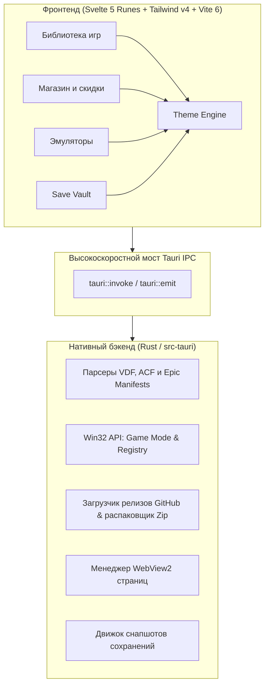

<div align="center">

  <h1>⚡ OmniLauncher</h1>

  <p><strong>Ультралёгкий, производительный игровой лаунчер нового поколения на базе Tauri v2, Svelte 5 и Rust.</strong></p>
  <p><em>The ultra-lightweight, high-performance desktop gaming launcher built with Tauri v2, Svelte 5 & Rust.</em></p>

  [](https://github.com/Tmub1k/TMlauncher/releases)
  [](https://github.com/Tmub1k/TMlauncher/actions)
  [](https://tauri.app/)
  [](https://www.rust-lang.org/)
  [](https://svelte.dev/)
  [](LICENSE)

  <br />

  [📥 Скачать установщик (Releases)](https://github.com/Tmub1k/TMlauncher/releases/latest) • [✨ Возможности](#-возможности) • [⚙️ Настройки](#️-настройки-и-конфигурация) • [🎨 Темы](#-модульные-темы-оформления) • [🏗️ Архитектура](#️-архитектура) • [👥 Авторы](#-авторы-и-благодарности)

</div>

---

## 📖 О проекте (Overview)

**OmniLauncher** — это единый игровой хаб для ПК с открытым исходным кодом, созданный как быстрая, стильная и легковесная альтернатива громоздким лаунчерам. Он объединяет ваши игры из **Steam**, **Epic Games**, **Roblox**, инди-магазина **itch.io** и ретро-эмуляторов в единой библиотеке с графитовой эстетикой TURA, потребляя **менее 45 МБ оперативной памяти** и 0% CPU во время игр.

### 🌟 Преимущества OmniLauncher:
- ⚡ **Мгновенный отклик**: холодный старт менее 400 мс благодаря Tauri v2 и компиляции в нативный машинный код.
- 🧹 **Zero-Footprint Game Mode**: автоматическая заморозка интерфейса и сброс рабочего набора ОЗУ при старте игры.
- 🗃️ **Умная дедупликация**: объединение одинаковых игр из разных магазинов в одну карточку с выбором источника.
- 🛡️ **Save Vault (Машина времени)**: автоматическое создание версионных резервных копий и снапшотов сохранений (Steam Cloud и локальных).
- 🌐 **Встроенный магазин без ограничений**: просмотр страниц Steam Store через изолированный WebView2 прямо внутри лаунчера без внешних окон.
- 🎨 **Модульный движок тем**: поддержка адаптивных тем с эффектами Mica, Acrylic и размытием стекла.

---

## ✨ Возможности

### 🎮 Единая библиотека и платформы
- **Steam**: чтение локальных VDF манифестов (`libraryfolders.vdf`, `remotecache.vdf`), синхронизация сохранений, починка рассинхронизации достижений и 1-клик привязка ключа Steam API.
- **Epic Games Store**: автоматическое обнаружение установленных и купленных игр из манифестов `.item`.
- **Roblox**: парсинг сессий из логов, автоматическое определение названий плейсов через официальные API, запуск в 1 клик, редактор FastFlags и менеджер мульти-инстансов.
- **itch.io**: встроенная лента инди-игр и новинок.
- **Кастомные игры**: добавление любых сторонних `.exe`, `.bat`, `.lnk` игр и программ с постерами.

### 🕹️ Хаб эмуляторов (1-Click Install)
- Готовые предустановки и мгновенное скачивание проверенных релизов с официальных GitHub репозиториев:
  - **RetroArch**, **Dolphin**, **PCSX2**, **RPCS3**, **DuckStation**, **Ryujinx**, **PPSSPP**.

### 🛒 Умный магазин и рекомендации
- Персональные рекомендации на основе предпочтений пользователя (`dynamicstore/userdata`).
- Корректная поддержка валют: **KZT (₸)**, **RUB (₽)**, **USD ($)** с точным региональным пересчётом.
- Встроенный полноэкранный браузер магазина на базе WebView2 с сохранением пользовательских куки и авторизации.

### 🛡️ Снапшоты сохранений и оптимизация
- **Save Vault**: создание zip-снапшотов прогресса до и после игровых сессий с восстановлением в один клик.
- **Shader Reclaimer**: очистка кэшей шейдеров DirectX, Vulkan и Steam для освобождения дискового пространства.

---

## 🎨 Модульные темы оформления

Лаунчер включает в себя 8 встроенных тем оформления с аппаратным ускорением Windows Vibrancy (Mica / Acrylic):

| Тема | Идентификатор | Описание | Vibrancy |
| :--- | :--- | :--- | :--- |
| **TURA Graphite** | `tura-graphite` | Минималистичный скандинавский графит (по умолчанию) | Mica |
| **Liquid Chrome** | `liquid-chrome` | Металлический блеск и хромированные акценты | Acrylic |
| **Obsidian Pure** | `obsidian-pure` | Глубокий 100% чёрный фон для OLED дисплеев | None |
| **Cyber Aurora** | `cyber-aurora` | Неоновый киберпанк градиент с фиолетовыми переливами | Acrylic |
| **Стекло (Glass Dark)** | `glass` | Тёмное полупрозрачное стекло с размытием 24px | Acrylic |
| **Белое стекло (White Glass)** | `white-glass` | Светлый матовый акрил frosted glass | Acrylic |
| **Зелёный (Emerald)** | `green` | Изумрудно-неоновая гамма со свечением | Mica |
| **Жёлтый (Amber Gold)** | `yellow` | Янтарно-золотой киберпанк с высокой контрастностью | Mica |

Темы хранятся в формате JSON в директории `themes/` и поддерживают горячую замену без перезапуска приложения.

---

## ⚙️ Настройки и конфигурация

Все параметры доступны во встроенном меню настроек (**Настройки** в верхнем меню):
1. **Steam интеграция**:
   - Кнопка **«Авто-определение Steam»** автоматически считывает активный профиль и подтягивает API ключ.
2. **Сеть и обход блокировок**:
   - Поддержка DNS-over-HTTPS (DoH): Cloudflare, Google, Quad9.
   - Настройка глобального SOCKS5 / HTTP прокси для загрузки метаданных и обложек.
3. **Эко-режим и производительность**:
   - Автоматический сброс фонового потребления памяти при запуске игр.
   - Заморозка видео-превью и анимаций для сохранения ресурсов процессора.

---

## 📥 Установка и запуск

### Вариант 1. Установщик для Windows (Рекомендуется)
1. Перейдите в раздел [Releases](https://github.com/Tmub1k/TMlauncher/releases/latest).
2. Скачайте `OmniLauncher_0.1.2_x64-setup.exe`.
3. Запустите установщик и следуйте простым инструкциям на экране.

### Вариант 2. Сборка из исходников

#### Требования:
- [Node.js](https://nodejs.org/) (версия 20 или новее)
- [Rust & Cargo](https://rustup.rs/) (версия 1.80+)
- Visual Studio C++ Build Tools 2022
- Windows 10/11 с установленным компонентом WebView2

```powershell
# 1. Клонирование репозитория
git clone https://github.com/Tmub1k/TMlauncher.git
cd TMlauncher

# 2. Установка зависимостей
npm install

# 3. Запуск в режиме разработки
npm run tauri dev

# 4. Сборка релизного инсталлятора
npm run tauri build
```

---

## 🏗️ Архитектура



---

## 👥 Авторы и благодарности

- **Автор и ведущий разработчик:** [Tmub1k](https://github.com/Tmub1k)
- **Технологический стек:**
  - Команда [Tauri](https://tauri.app/) за легковесный фреймворк десктопных приложений.
  - Команда [Svelte](https://svelte.dev/) за передовую реактивную систему Runes.
  - Сообщество Rust за экосистему безопасного и производительного системного ПО.

---

## 📄 Лицензия

Проект распространяется под открытой лицензией [MIT License](LICENSE).

*Правовая оговорка: OmniLauncher является независимым проектом с открытым исходным кодом и не аффилирован с Valve Corporation, Epic Games, Roblox Corporation или иными правообладателями.*
